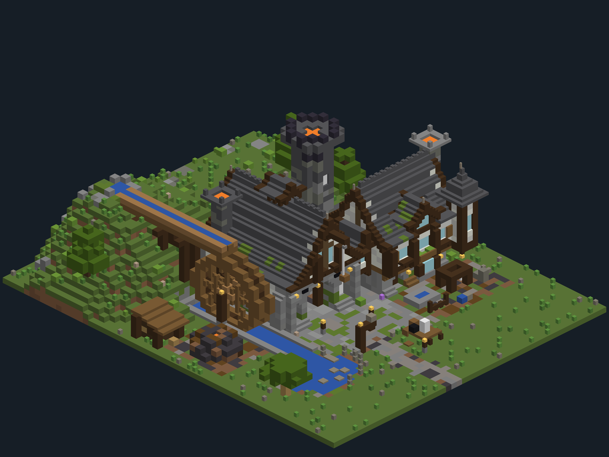
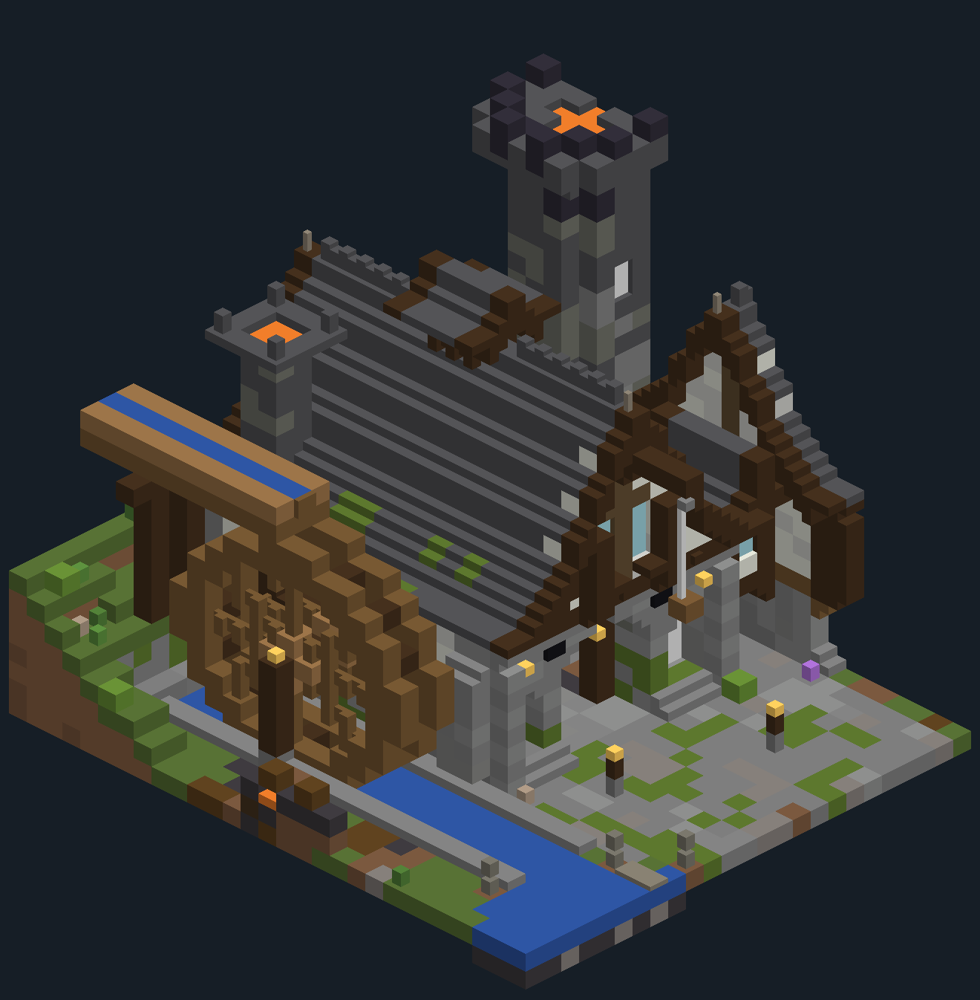

# minecraft-elite-builder

A [Claude Code](https://claude.com/claude-code) skill that lets Claude design and build Minecraft
structures at the level of the best professional build teams, in code.
Claude writes the building as a Python script, checks it by numbers, looks at renders of it, fixes
it, and hands you a `.schem` you paste with WorldEdit or FAWE.



*The worked example, `examples/forge_legendary.py`, as the skill's renderer draws it: a
water-powered hammer mill of three generations. It is 62 by 51 by 28, about 16,100 blocks, with no
entities.*

## Why it works this way

Claude can't see Minecraft. So instead of placing blocks by eye, it:

1. **Writes the building as a Python script** that places every block by coordinates in the
   building's own frame: across the front, back into the hill, up. A rerun gives the same build,
   and a fix is one line.
2. **Resolves and connects it.** Weighted palettes are picked in patches. Panes, fences, walls and
   stair corners get the states the game would give them, because a pasted schematic gets no
   neighbour updates.
3. **Checks it by numbers**:
   - nothing floating;
   - nothing hanging on air (trapdoors, ladders, signs, lanterns);
   - nothing flammable near lava;
   - every floor reachable on foot from the path.
4. **Renders PNGs**: a hero view from the front corner, the other three corners, four flat sides,
   the plan from above, and close-ups in true stair and slab shapes. Claude reads the images, finds
   what a good builder would point at, and fixes it. A legendary build takes several passes.
5. **Writes a Sponge v2 `.schem`** for WorldEdit and FAWE.

The skill also carries the method: how an expert approaches a build (story, massing, scale, depth,
curves, texture, detail, interior, ground, light), block recipes that worked, and every pitfall
already paid for.



## Requirements

- **Claude Code**: the CLI, the desktop app or an IDE extension.
- **Python 3.9 or newer**, with **numpy** (`pip install numpy`). Nothing else.
- **A Minecraft server with WorldEdit or FAWE** to paste the result. The schematics are written for
  Minecraft 26.2 (data version 4903); for another version, change `DATA_VERSION` in
  `scripts/schem.py`.

## Installation

Claude Code finds skills in `~/.claude/skills/<name>/` (for every project) or in
`<project>/.claude/skills/<name>/` (for one project). The folder must be called
`minecraft-elite-builder`.

**For all your projects:**

```bash
git clone https://github.com/myzticbean/minecraft-elite-builder-skill.git ~/.claude/skills/minecraft-elite-builder
```

**For one project** (run in the project's root; commit it if your team should have it too):

```bash
git clone https://github.com/myzticbean/minecraft-elite-builder-skill.git .claude/skills/minecraft-elite-builder
```

On Windows PowerShell, `~` works too, or use `$HOME\.claude\skills\minecraft-elite-builder`.

Then start a new Claude Code session. Ask "what skills do you have?" or type `/` to check that
`minecraft-elite-builder` is listed.

**Updating:** `git pull` inside the skill's folder.

## Usage

Ask for a build, or call the skill by name:

```
/minecraft-elite-builder Build an apothecary for my village, your own design, legendary tier.
It sits on a hill that rises to the east.
```

```
Use the minecraft-elite-builder skill. Here are three screenshots of a Tudor inn I like;
build it as a schematic, dug into a slope.
```

What happens:

1. **Claude asks first.**
   - Do you have reference images, or should it make its own design (with named inspirations,
     never a copy)?
   - Which tier: a trial (basic) build or a legendary one?
   - What is the building for, and what is the site (slope, room)?

   The look is yours to direct.
2. **On the first build in a project**, Claude copies `scripts/` into a build folder in your
   project (for example `builds/`). Your build scripts live there from then on.
3. **It writes the design notes**: the story, the parts of the trade, and the footprint, walls,
   roof and props. Then it writes the script.
4. **It runs the loop**: block-out, structure, depth, texture, detail and interior, ground, light,
   review. Expect it to show you renders along the way.
5. **It gives you** `<build>.schem` and the paste steps.

### Pasting in game

1. Copy the `.schem` into the server's `plugins/WorldEdit/schematics/` folder (or
   `plugins/FastAsyncWorldEdit/schematics/`).
2. `//schem load <build>`.
3. Stand where the build's `GATE` is: the spot on the path in front of the entrance.
4. `//paste`.

Notes on pasting:

- The front faces **west**: face east to look at it, or `//rotate` the clipboard before pasting.
- Empty cells in the box paste as air, so a plain `//paste` clears what stood there. `//paste -a`
  keeps it.
- `//undo` takes it all back.

### Running it yourself

```bash
python builds/<build>.py renders/<name>      # checks, PNG renders, and the .schem
python builds/review.py builds/<build>.py close renders/<name> -10 10 -5 15
python builds/review.py builds/<build>.py cut renders/<name> 5 -10 10 -5 15
python builds/review.py builds/<build>.py dump v 0 0 10 -7 7
```

Try the example straight from the skill folder:

```bash
python examples/forge_legendary.py /tmp/forge
```

It prints the checks, then `good`, writes `/tmp/forge-*.png`, and writes
`examples/forge_legendary.schem`.

## What's in it

| Path | What |
|---|---|
| `SKILL.md` | What Claude reads: what to ask, setup, the loop, the hard rules, the checks, delivering. |
| `references/method.md` | How an expert builds, plus the tiers and a style table. |
| `references/toolkit.md` | The drawing frame, which way each block faces, the API, the review tool, and a build-script template. |
| `references/vocabulary.md` | Block recipes that worked: walls, jetties, bellcast roofs, arches, chimney crowns, a water wheel, water, light, furniture, palettes. |
| `references/pitfalls.md` | Every trap so far and the rule that prevents it. |
| `scripts/draw.py` | The drawing: boxes, lines, palettes, profiled roofs with thin barge boards, spires, arches, and helpers for facings. |
| `scripts/look.py` | Resolve, connect, check, and render (isometric, elevations, sub-block close-ups). |
| `scripts/schem.py` | Writes and reads Sponge v2 schematics. |
| `scripts/review.py` | Close views, cutaways, and a cell dump of one plane, for any build script. |
| `examples/forge_legendary.py` | The worked example: about 1,050 lines and five review passes. |

## Principles the skill holds to

- **Built things belong where they stand**: dug into slopes and stepped with the ground, never on a
  levelled pad or a raised platform.
- **Cheap to run**: no entities, every ticking block counted (campfires, lava, water), no vines.
- **Depth on every face**: the plane, structure a block proud, projections and recesses.
- **Curves over 45° lines**: bellcast roofs, round arches, corbels, round and octagonal forms.
- **Texture with a reason**: dirty at the foot, soot near fire, moss where water runs, in patches.
- **Your project's rules win.** If the project has a `CLAUDE.md` with build rules, Claude follows
  those over the skill.

## Limits

- Renders are coloured by block name, not textured. They judge shape, value and composition; the
  textures show in game.
- Schematics carry no block-entity data: chests are empty, and signs and banners are blank.
- Building a legendary piece is long work: about a thousand lines and several render passes. A trial
  build is a few hundred lines and one or two passes.

## Credits and inspirations

Made by [myzticbean](https://github.com/myzticbean). Inspired by:

- the work of professional Minecraft build teams;
- the towns and smithies of famous RPGs;
- other AI building tools for Minecraft.

Most of the renderer's colours are the average colours of the game's own textures.

## License

GPL-3.0. See [LICENSE](LICENSE).
